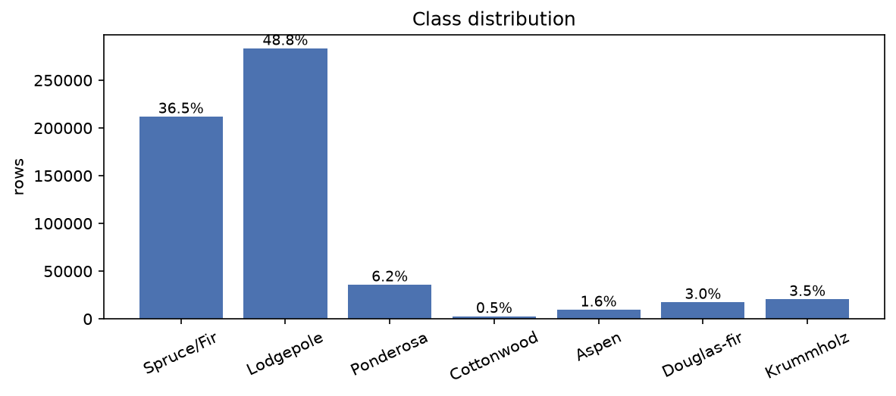
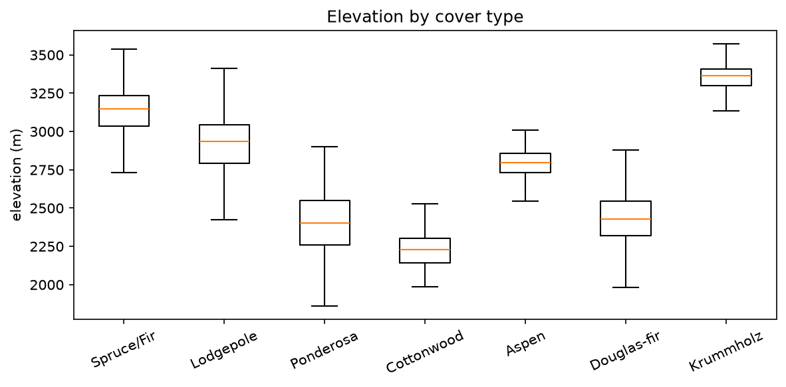
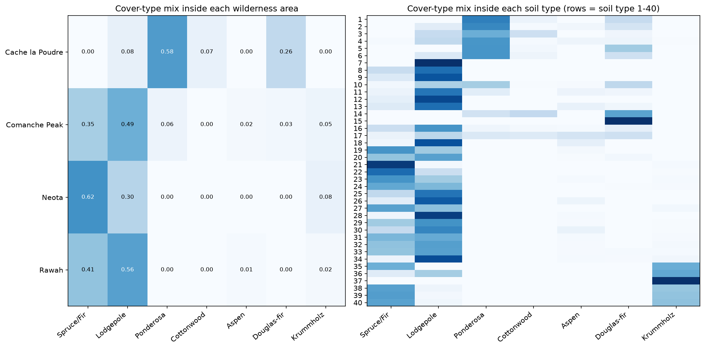
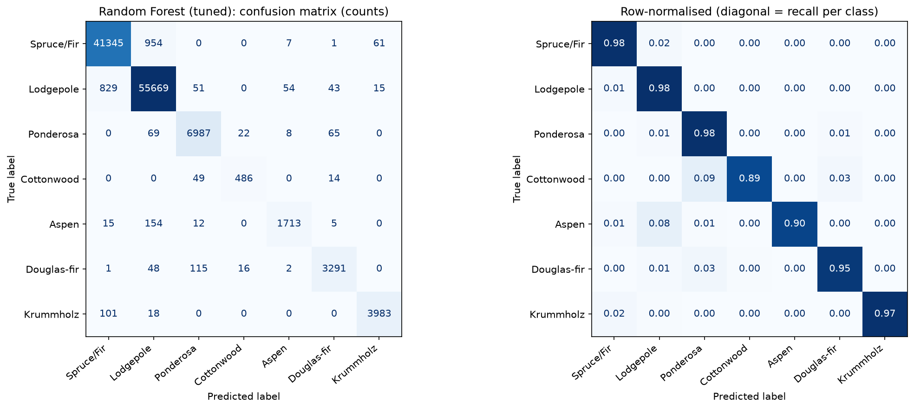
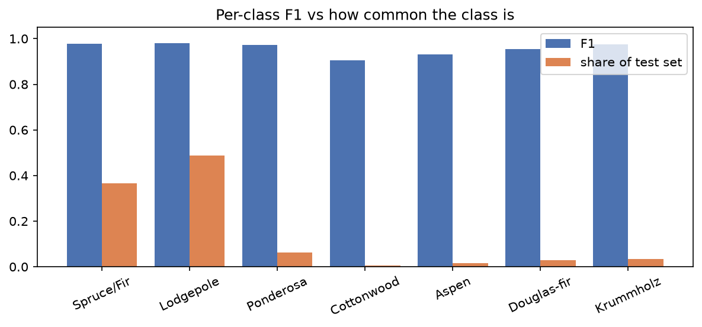
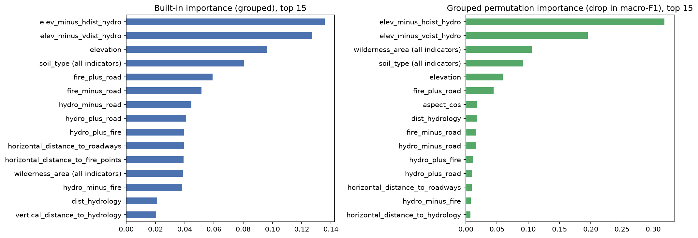
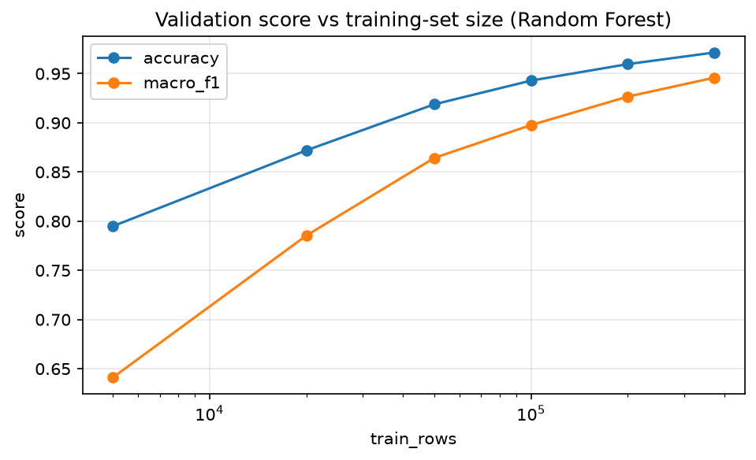

# Forest Cover Type Classification

A multi-class classification project that predicts the **forest cover type** (7 classes) of a 30 m x 30 m land cell from cartographic and environmental features, comparing tree-based models (Random Forest vs XGBoost) with hyperparameter tuning.

Built as a **Level 2 Machine Learning task** of the Elevvo Internship Program.

**Headline results**
- **Within the surveyed forest** (random 80/20 split): test accuracy **97.65%**, macro-F1 **0.9567** on 116,203 held-out cells.
- **Into an unseen wilderness area** (leave-one-area-out): accuracy only **29-60%**. The model fills gaps inside a surveyed forest well, but it does not transfer to a new area.

---

## Table of Contents
- [Project Overview](#project-overview)
- [Dataset](#dataset)
- [Approach](#approach)
- [Results](#results)
- [Key Findings](#key-findings)
- [Project Structure](#project-structure)
- [Getting Started](#getting-started)
- [Limitations](#limitations)
- [Future Work](#future-work)
- [Author](#author)

---

## Project Overview

**What this project covers**
- Schema validation, one-hot integrity checks and data-quality checks
- Categorical handling: decoded for EDA, kept as binary indicators for modelling
- An **ablation** deciding whether engineered combination features earn their place
- Dummy, Logistic Regression, Decision Tree, Random Forest (plain and class-balanced) and XGBoost
- Hyperparameter tuning (`RandomizedSearchCV`) for Random Forest and XGBoost
- Final test evaluation: per-class report, confusion matrices, most common mistakes
- Feature importance two ways (built-in and grouped permutation importance)
- A learning curve and a **leave-one-wilderness-area-out stress test** for spatial generalisation

**Tech stack:** Python 3.12, pandas, scikit-learn, XGBoost, matplotlib, joblib, Jupyter

---

## Dataset

- **Source:** [UCI Covertype](https://archive.ics.uci.edu/dataset/31/covertype), loaded with `sklearn.datasets.fetch_covtype`
- **Size:** 581,012 rows x 54 features + 1 target
- **Area:** Roosevelt National Forest, Colorado (four wilderness areas)
- **Target:** `Cover_Type`, 7 classes

| Class | Share of data |
|---|---|
| Lodgepole Pine | 48.8% |
| Spruce/Fir | 36.5% |
| Ponderosa Pine | 6.2% |
| Krummholz | 3.5% |
| Douglas-fir | 3.0% |
| Aspen | 1.6% |
| Cottonwood/Willow | 0.5% |

A model that always predicts Lodgepole Pine already scores **48.8% accuracy**, which is why macro-F1 is the headline metric.

| Features | Type |
|---|---|
| Elevation, aspect, slope, distances to hydrology / roadways / fire points, vertical distance to hydrology, three hillshade indices | 10 continuous |
| `wilderness_area` (4) and `soil_type` (40) | 44 one-hot binary |

- **Data-quality notes:** TODO (paste: missing values, duplicate rows, constant columns, rare soil types)
- **Structure found in EDA:** elevation separates classes but overlaps strongly (Spruce/Fir vs Lodgepole, Ponderosa vs Douglas-fir). Wilderness area is a strong geographic signal: Cache la Poudre is 58% Ponderosa and holds the Cottonwood class, and Neota is 62% Spruce/Fir. Hillshade features are correlated with aspect and with each other, because they are derived from aspect and slope.

---

## Approach

1. **Load and validate:** schema assertions, float32 / int8 downcasting, one-hot integrity check (exactly one wilderness area and one soil type per row), value-range checks.
2. **EDA:** class balance, feature distributions, elevation by class, cover-type mix by wilderness area and soil type, feature correlations.
3. **Engineered features:** row-wise formulas such as `elevation - 0.2 x horizontal_distance_to_hydrology`, `elevation - vertical_distance_to_hydrology`, sums and differences of the distance columns, Euclidean distance to water, and aspect sine/cosine. These formulas are known from prior work on this dataset and use no fitted statistics, so they cannot leak.
4. **Splits (stratified):** 80% train / 20% test. Train is split again into fit (80%) and validation (20%). The test set was used once, for the final model.
5. **Ablation:** a Random Forest on a 100k-row subsample with and without the engineered features, adopted only if macro-F1 improves by more than 0.003.
6. **Model comparison** on fit/validation, then **tuning** on a 50k-row subsample (3-fold, 6 candidates per model, macro-F1), refitting the best settings on all fit rows.
7. **Final model:** the best validation model refitted on all 464,809 training rows and scored once on the test set.
8. **Analysis:** importance, learning curve, and leave-one-area-out stress tests with three feature variants.

---

## Results

### Engineered-feature ablation (Random Forest, 100k-row subsample, validation set)

| Feature set | Features | Accuracy | Macro-F1 |
|---|---|---|---|
| Original columns | 54 | 0.9089 | 0.8496 |
| **Original + engineered** | **65** | **0.9441** | **0.9001** |

### Model comparison (fit on 371,847 rows, scored on validation)

| Model | Accuracy | Macro-F1 | Weighted-F1 | Fit time (s) |
|---|---|---|---|---|
| **Random Forest (tuned)** | 0.9738 | 0.9489 | 0.9738 | 112.5 |
| XGBoost (tuned) | 0.9676 | 0.9486 | 0.9676 | 197.6 |
| XGBoost | 0.9729 | 0.9480 | 0.9729 | 178.7 |
| Random Forest | 0.9725 | 0.9474 | 0.9725 | 53.4 |
| Random Forest (balanced) | 0.9727 | 0.9466 | 0.9726 | 66.5 |
| Decision Tree | 0.9457 | 0.9066 | 0.9457 | 31.7 |
| Logistic Regression (100k rows) | 0.7236 | 0.5330 | 0.7145 | 7.9 |
| Dummy (majority) | 0.4876 | 0.0936 | 0.3196 | 0.0 |

Fit times are hardware-dependent (laptop, 12 threads). Re-running the notebook reproduced every metric to four decimals, and only the times changed.

**Selected model:** Random Forest (tuned), with parameters TODO.

### Final test-set performance (tuned Random Forest, 116,203 cells)

| Metric | Value | 95% bootstrap CI |
|---|---|---|
| Accuracy | 0.9765 | TODO |
| Macro-F1 | 0.9567 | TODO |
| Weighted-F1 | 0.9765 | n/a |

| Class | Precision | Recall | F1 | Support |
|---|---|---|---|---|
| Spruce/Fir | 0.9776 | 0.9759 | 0.9767 | 42,368 |
| Lodgepole Pine | 0.9782 | 0.9825 | 0.9803 | 56,661 |
| Ponderosa Pine | 0.9685 | 0.9771 | 0.9728 | 7,151 |
| Cottonwood/Willow | 0.9275 | 0.8852 | 0.9059 | 549 |
| Aspen | 0.9602 | 0.9021 | 0.9302 | 1,899 |
| Douglas-fir | 0.9626 | 0.9476 | 0.9550 | 3,473 |
| Krummholz | 0.9813 | 0.9710 | 0.9761 | 4,102 |

**Most common mistakes**

| True class | Predicted as | Count | Share of true class |
|---|---|---|---|
| Spruce/Fir | Lodgepole Pine | 954 | 2.25% |
| Lodgepole Pine | Spruce/Fir | 829 | 1.46% |
| Aspen | Lodgepole Pine | 154 | 8.11% |
| Douglas-fir | Ponderosa Pine | 115 | 3.31% |
| Krummholz | Spruce/Fir | 101 | 2.46% |
| Ponderosa Pine | Lodgepole Pine | 69 | 0.96% |
| Ponderosa Pine | Douglas-fir | 65 | 0.91% |
| Spruce/Fir | Krummholz | 61 | 0.14% |

### Feature importance (top features)

| Feature | Built-in | Permutation drop in macro-F1 |
|---|---|---|
| `elev_minus_hdist_hydro` | 0.136 | 0.318 |
| `elev_minus_vdist_hydro` | 0.127 | 0.195 |
| wilderness area (all indicators) | 0.039 | 0.106 |
| soil type (all indicators) | 0.081 | 0.091 |
| `elevation` | 0.096 | 0.059 |
| `fire_plus_road` | 0.059 | 0.045 |

### Learning curve (Random Forest, validation set)

| Training rows | Accuracy | Macro-F1 |
|---|---|---|
| 5,000 | 0.7948 | 0.6409 |
| 20,000 | 0.8720 | 0.7853 |
| 50,000 | 0.9188 | 0.8643 |
| 100,000 | 0.9429 | 0.8977 |
| 200,000 | 0.9597 | 0.9267 |
| 371,847 | 0.9715 | 0.9459 |

### Stress test: leave-one-wilderness-area-out

Train on three areas (up to 100k rows), test on the fourth. Only training-split rows are used.

| Held-out area | Rows | Most common class in area (approx.) | Accuracy | Macro-F1 | Notes |
|---|---|---|---|---|---|
| Rawah | 208,521 | Lodgepole, 56% | 0.5976 | 0.3786 | |
| Neota | 23,870 | Spruce/Fir, 62% | 0.5372 | 0.4216 | |
| Comanche Peak | 202,787 | Lodgepole, 49% | 0.5974 | 0.2821 | |
| Cache la Poudre | 29,631 | Ponderosa, 58% | 0.2900 | 0.1976 | Cottonwood never seen in training |

For comparison, a random split at the same 100k training size gives 0.943 accuracy.

**Accuracy under three feature variants**

| Held-out area | All features | No area indicators | Continuous terrain only |
|---|---|---|---|
| Rawah | 0.598 | 0.589 | 0.576 |
| Neota | 0.537 | 0.524 | 0.526 |
| Comanche Peak | 0.597 | 0.603 | 0.593 |
| Cache la Poudre | 0.290 | 0.406 | 0.405 |

**Original vs engineered features under leave-one-area-out:** TODO (paste the table from the final Section 10 cell)

### Visuals









---

## Key Findings

- **Best model:** a tuned Random Forest with 65 features reaches test accuracy **0.9765** and macro-F1 **0.9567**. The majority-class baseline is 48.8%.
- **Feature engineering was the largest lever.** On a 100k-row subsample it raised validation macro-F1 from 0.850 to 0.900 (the gain at full data size was not measured). The strongest feature is elevation minus a fraction of the horizontal distance to water.
- **Tuning and model choice barely mattered.** The four best tree ensembles span 0.9474-0.9489 macro-F1. Tuning added +0.0015 for the forest and nothing for XGBoost, whose tuned accuracy was *lower* than its default (0.9676 vs 0.9729), a sign that settings chosen on a 50k subsample under-fit the full data. Class weighting did not help, and the Random Forest fit about 3x faster than default XGBoost.
- **The classes are not linearly separable.** Logistic Regression reaches only 72% accuracy, while a single decision tree already gets 94.6%, and ensembling adds a further 2.7 points.
- **Errors are between ecological neighbours.** 65% of test errors are Spruce/Fir <-> Lodgepole confusions. The rarest classes have the lowest recall (Cottonwood 0.885, Aspen 0.902), below their precision.
- **The model is data-limited.** Macro-F1 still gains about +2 points per doubling of training data at 372k rows.
- **It does not generalise to a new area.** Holding out a whole wilderness area drops accuracy from about 94-97% to 29-60%. Removing the area indicators changes accuracy by at most 1.4 points in three of four areas, and using terrain features only by at most 2.2 points. The exception is Cache la Poudre, where removing area indicators gains 11.6 points because the unseen area's own indicator is undefined. The weak transfer is therefore mostly genuine regional shift, not an encoding artifact. Rawah and Comanche Peak have similar class mixes, yet each scores only about 60% when held out, so the elevation-to-species relationship itself differs by area.
- **Engineered features across areas:** TODO (state whether the original features perform the same under leave-one-area-out)

---

## Project Structure

```
Forest-Cover-Type-Classification/
├── forest_cover_type_classification.ipynb   # Full analysis (with outputs)
├── requirements.txt
├── README.md
├── .gitignore
├── images/                                  # Figures saved by the notebook
└── results/                                 # Result tables (CSV)
```

(`models/` is created by the notebook but kept out of Git because forests are large.)

---

## Getting Started

**Prerequisites:** Python 3.12 (avoid pre-release versions), Git, about 8 GB free RAM.

```bash
git clone https://github.com/AbeshuK/Forest-Cover-Type-Classification.git
cd Forest-Cover-Type-Classification
python -m venv .venv
.\.venv\Scripts\Activate.ps1        # Windows PowerShell
pip install -r requirements.txt
```

**Run**
1. Open the notebook and select the `.venv` kernel.
2. Set `FAST_MODE = True` first for a quick dry run on a 60k-row subsample (a few minutes).
3. Set `FAST_MODE = False` and use **Restart and Run All** for the full results. This takes a long time on a laptop, mostly the hyperparameter search and the refits of the tuned forests, so run it when you can leave it.
4. The dataset downloads automatically through scikit-learn. If you are offline, download `covtype.data.gz` from UCI and set `DATA_SOURCE` to its path.

**`requirements.txt`**
```
pandas
scikit-learn
xgboost
matplotlib
joblib
ipykernel
jupyter
```

---

## Limitations

- **Spatial autocorrelation:** neighbouring cells are very similar, so random splits are optimistic. Leave-one-area-out accuracy of 29-60% is the pessimistic bound, since an entire area is withheld. Real use would fall between the two, depending on how close the labeled cells are. The dataset has no coordinates, so finer spatial blocking was not possible.
- **One region only:** the model learns Roosevelt National Forest, not forests in general.
- **Cartographic variables only:** no satellite imagery, so classes that differ by canopy rather than terrain stay hard to separate.
- **Engineered features come from known dataset tricks:** they were chosen before looking at the results, but they are not new discoveries. Distance sums and differences may act as location fingerprints.
- **Search budget:** hyperparameters were searched on a 50k subsample with 6 candidates per model, and the tuned XGBoost under-performed its default.
- **Importance caveats:** permutation importance is diluted across correlated features, and shuffling area labels creates unrealistic rows.
- **Not addressed:** probability calibration and cost-sensitive rules for rare classes.

---

## Future Work

- Test few-shot adaptation: how many labeled cells from a new area are needed to recover accuracy?
- Area-normalised features (for example elevation relative to each area's own range)
- Spatially blocked cross-validation on data with coordinates
- LightGBM / CatBoost comparison, calibrated probabilities, class-specific thresholds
- Prune redundant aspect and hillshade features and re-check accuracy

---

## Author

**Abeshu Kebede**
Software Engineer | Machine Learning Intern at Elevvo
Portfolio: [abeshukebede.vercel.app](https://abeshukebede.vercel.app)

---

## Acknowledgments

- Covertype data from the UCI Machine Learning Repository, originally compiled by Blackard and Dean (Colorado State University) from US Forest Service and USGS data
- Elevvo Internship Program for the task design